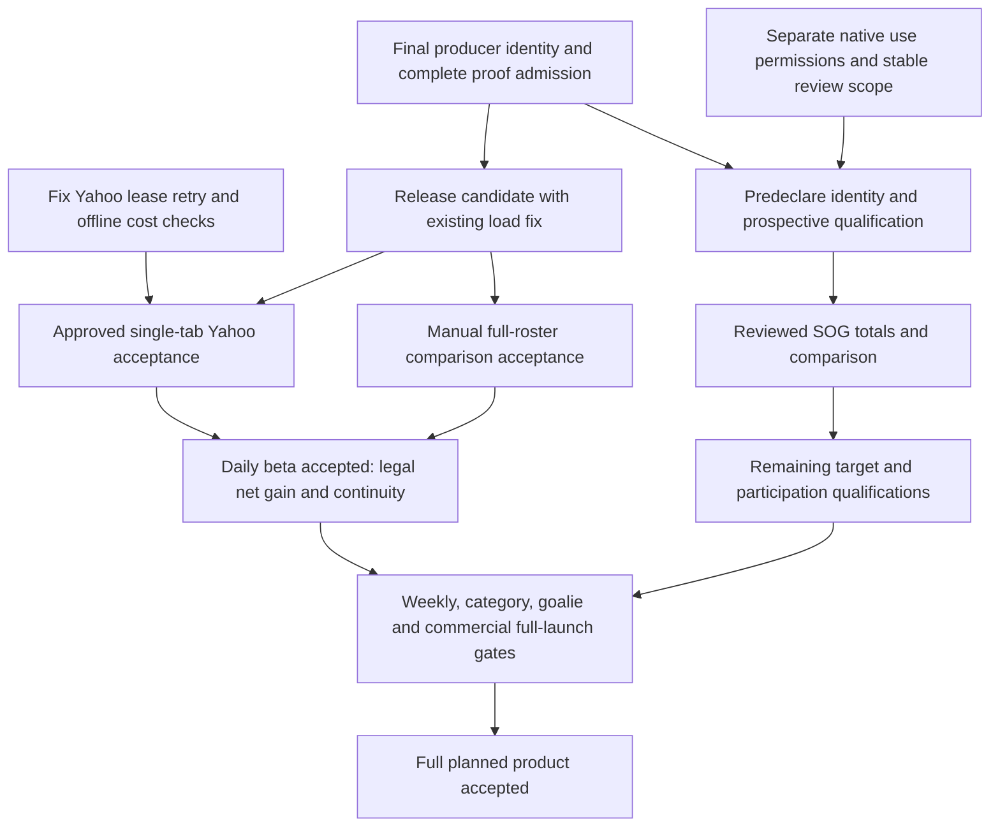

# Independent Astra audit — RSO / FORGE

2026-10-26. Read-only source review at `cd73cbd695347a04c0d217ca7535a87ca609f4fb`.

The shortest sound path is to finish the forecast-to-planner connection, not replace the planner. Existing legal assignment, timed moves, marginal comparison, and workspace reconciliation are substantial and reusable. The full user outcome is still unaccepted: usable forecasts for the actual roster and available pickups, a legal drop/add with the dropped contribution included, and the same understandable plan after refresh, Undo, save and reopen.

The next implementation package should close release attribution and the remaining consumer paths, carry the existing offline-load fix, and demonstrate that complete flow with the approved interim bridge. Native SOG qualification can proceed alongside that work once its permission contract is made usable. SOG alone is neither full-league points nor permission to use quality forecasts for assignment. Weekly leagues and the rest of the original product remain explicit later acceptance gates.

## 1. Authority, identity and what was verified

Source root **R** = `/Users/tim/Code/fhfhockey.com`; code references below are relative to R unless linked otherwise. Handoff **H** = `R/tasks/artifacts/astra-rso-handoff-2026-10-26`. Archive **A** = `/Users/tim/Code/fhfhockey-workspace-recovery-2026-10-24/clean-checkout-2026-10-25-1505/files`. All audit output is in this separate directory. Root AGENTS.md, mise-en-place, the relevant leases and chronological mailboxes were read. Claude's RSO/FORGE custody and pause are preserved. A new unrelated Player Cards handback appeared during the audit; it does not transfer RSO ownership.

| Identity | Independently observed locally | Interpretation |
|---|---|---|
| Checkout / branch | R / `octoberBranch` | Sole source editing checkout; this auditor did not edit it |
| HEAD | `cd73cbd695347a04c0d217ca7535a87ca609f4fb` | Local candidate |
| Saved `origin/master` | `538100d41ee87e721d2764b694f7bac8c2f2bb34` | Production identity according to supplied release receipt, not a fresh remote/deployment read |
| Saved `origin/octoberBranch` | `28335fd466ef5a989b7a223d47681cfe5db65723` | Distinct commit; not HEAD or production SHA |
| Ahead of saved origin/octoberBranch | Exactly 5 commits | `5356dc616` load fix; `9eb4f0d36` consumer guard; `97315cff3` discovery exclusion; `3795abb43` Yahoo diet off; `cd73cbd69` exact-release fallback |

The saved origin refs have identical `web/` and `supabase/` contents, but different whole trees (854 changed paths, mainly task records). “Tree unchanged” must be qualified by scope. No remote fetch verified whether the server has advanced. Initial and final refs agree; every original pinned working-tree source remained unchanged. Nothing staged. Existing modified `web/next-env.d.ts`, `web/public/teamLogos/OTT.png` and untracked `OTT-2.png` were untouched. Full worktree inventory, including historical/prunable entries, was recorded without pruning.

**Pin correction:** CODE-PINS.md contains **195 file rows**, not the stated 196, and identifies the prior `3795abb43` cut. All 195 match that cut; 193 match HEAD. The two changed files are `web/lib/projections/externalInputProof.ts` and `web/lib/rosterScheduleData/forgeDailyBridge.test.ts`, both changed by cd73 and matching HEAD in the working tree. The newer allowlist/verifier and related tests were separately pinned. This is document drift, not unexplained source modification. [Full comparison](source-pin-verification.json), [supplemental pins](supplemental-source-pins.json), [initial identity](identity-start.json), [final identity](identity-end.json).

**Independent offline evidence:** 577 tests passed across 14 focused files under a network-denying preload and isolated Vite configuration. These include manual/Yahoo acceptance fixtures, the planner, bridge, workspace, rule/retention logic, proof admission, and three audit tests. One audit test is a positive control; two reproduce native-use defects below. No network attempt was recorded. This is not a full gate, browser acceptance, production availability test or scientific qualification. Prior broad-suite/TS/browser results remain attributed historical receipts. [Log](offline-tests-4.log), [reproductions](reproduction.test.ts), [commands and limits](COMMANDS.md).

## 2. What works and must be retained

- The original pure TypeScript schedule/capacity engine, eligibility matching and DUST/bench accounting. Current planning uses legal slots, not gross NHL games as a substitute for startable games.
- Whole-roster evaluation, explicit no-move baseline, locked lineups, vacancies, reserve eligibility, protected drops, acquisition timing/periods and valid move prefixes. The optimizer can search bounded multi-move plans and explains bounds rather than proving a global optimum it did not search.
- Actual legal candidate-plan comparison: same baseline, reoptimized affected roster, net AGP and points only when eligible, and lost drop contribution. Do not replace this with team schedule rank, player gross projection, LVRP, or a hypothetical extra bench slot.
- Honest unknowns, target-level permissions and scope, pooled goalie ratios, credited/confirmed/projected distinctions, and incomplete-quality suppression. The recent bridge fixes for missing values and traded-goalie team/season shares must stay.
- One context workspace, intent separated from refreshed facts, reconciliation and Undo; per-account local storage plus anonymous manual workspace; protected account persistence with optimistic version conflict. Preserve the owner's legacy migration choice and context-switch isolation.
- Provider authority and manual corrections, verified availability rather than ownership-as-availability, full Yahoo discovery with incomplete-scan disclosure, and free/manual use of the same planner. Preserve Start Chart's specific 401/403 hide behavior.
- The labelled interim FORGE bridge, restricted to pre-native legacy selection. Keep native-use denial from silently switching to the bridge.
- The current proof design's distinction between absent evidence and contradictory evidence, exact-release allowlist, and refusal of uncertain attribution. Improve coverage and deployment continuity without weakening those protections.

Offline tests substantiate the corresponding algorithms and fixtures. They do not establish that all required live inputs exist for the current league.

## 3. Original vision reconciled with later decisions

[Requirement-by-requirement traceability](TRACEABILITY.md) covers all 18 consolidated functional requirements, original sources, later amendments, current code and verified gaps.

The governing sequence is the original engine doc → September plan → October 8 audited PRD → October 9 consolidated PRD with October 13 full-roster clarification → explicit October 25–26 owner decisions. A later receipt is implementation evidence, not authority to remove a requirement.

Material reconciliations:

1. September's proposed public-consensus/history blend is superseded by the explicit ban on pundit `PROJECTIONS_20262027_*` / `PROJECTIONS_20252026_*` inputs to FORGE/RSO and derived inputs. Their approved `/projections` and draft-dashboard use stays. Do not recover the old blend to make the UI populate.
2. The original demand for genuine forecast usefulness remains. Later owner approval permits an honestly labelled interim bridge for **daily manual/free plus Yahoo beta**. That is a staging decision, not completion of native forecasts or full launch.
3. October 13 requires full-roster legal weekly evaluation and actual legal drop/add marginal impact. The small two-player/one-head packet was only a checkpoint. The new SOG target is also a first qualification scope, not permission to remove G/A/PPP/HIT/BLK or W/GA/SV/SO from the selected full acceptance case.
4. SOG's adopted claim is unconditional h1 display plus RSO **totals/comparison**, with **assignment and conditional tie-break denied**. The planner currently cannot realize that distinction; finding F2 is an engineering mismatch, not a reason to ask TJ to approve assignment.
5. The consolidated maximum of 20 visible roster rows and internal scrolling supersedes the earlier “at least 20” layout amendment. Current layout should be accepted against the newer requirement, including 19/20/29-slot fixtures and mobile, not redesigned around the superseded wording.
6. Weekly leagues remain a full-launch gate. Fantrax is outside the chosen beta and is a separate parity track. Free no-input discovery is a later proposal; it must not replace the already approved free manual optimizer. Export/share/notifications are not silently added to initial scope.
7. Historical P1–P12 defaults are not uniformly approved. Freshness warnings are not automatic hard expiry, the 5% display aid is not a decision threshold, and automatic must-keep remains off. Old price proposals are not a reason to reopen settled access design.

## 4. All eight links traced

| Link | Current implementation and evidence | Exact remaining break / limit |
|---|---|---|
| 1. Provider/manual roster + rules | `web/lib/integrations/yahoo/rosterPlanning.ts:286`, `providerRules.ts:34` under optimizer; auth/capability route; manual workspace defaults | Yahoo R1 observed real roster/daily slots. Acquisition timing/counters and goalie-minimum semantics remain unverified where the provider does not supply authoritative facts. Manual manager input is legitimate; unknown must remain unknown. Fantrax route explicitly unavailable. |
| 2. Schedule + candidate pool | `web/components/RosterScheduleOptimizer/canonicalSchedule.ts:35`; Yahoo full scan `rosterPlanning.ts:559`; planning input mapping | R1 found 1,384 unique IDs, 815 catalog matches and 569 unmatched. Unmatched identities are a coverage limitation, not eligible zero-valued pickups. Complete scan is not complete forecast coverage. |
| 3. Native FORGE forecasts | `web/lib/rosterScheduleData/planning.ts:190` and `:218`; `forgeDailyBridge.ts:576`; `rsoUsePolicy.ts:45` | Production receipt is legacy/native-not-activated. Review catalog is empty. Bridge is available only under its explicit branch and proven run inputs. Actual newest-run admission cannot be established from supplied truncated-SHA receipt. F1/F3 block reliable future native operation. |
| 4. Legal lineup optimization | `web/lib/rosterScheduleOptimizer/planning.ts:374`, `:401`, `:924` | Exact assignment and schedule planning work in fixtures. Quality completeness is intentionally conservative. But assignment denial also disables totals/comparison even in AGP mode (F2). Do not grant assignment implicitly. |
| 5. Drop/add comparison | `planningTimeline.ts:25`; `planning.ts:1180`; `retention.ts:43`; `candidatePlanMetrics.ts:71` | Correct legal sequence/drop protection structure exists. Recommendation requires verified timing/budget, usable forecasts and legal full baseline. Real-account positive flow not yet witnessed. |
| 6. Actual startable marginal gain | `candidatePlanMetrics.ts:78`, `:160`, `:176`, `:192` | Net value compares complete baseline and complete candidate plan and reports drop loss. Bounded search (40 candidates / 160 evaluations / 12 proposals here) may miss alternatives; disclose scope. Native totals/comparison-only remains unusable under F2. |
| 7. Displayed recommendation | `web/components/RosterScheduleOptimizer/CandidateBrowser.tsx:65`, `:103`; `CandidateCard.tsx:48` | Displays legal-plan metrics and distinguishes schedule/context/unranked rows. A populated team row or gross projection is not end-to-end success. Keep partial target scope and no-improvement states explicit. No fresh visual run in this audit. |
| 8. Refresh / save / reopen | `workspace.ts:267`, `:303` under optimizer; `web/pages/api/v1/roster-schedule-optimizer/workspace.ts:123`; component upkeep `:561` | Storage/version/privacy/retention tests pass. Current read authorization must be reacquired after reopening. Production offline-flag stall has a local fix only. Yahoo lease busy loop must be fixed before diet-on. Live refresh → Undo → reopen and conflicting account save remain acceptance work. |

## 5. Confirmed findings, with repro and impact

### F1 — The exact-SHA fallback cannot sustain its own next deployment

**Confirmed release-design blocker, conditional on uncaptured runs.** `web/lib/projections/verifiedForgeReleases.ts:20` allows only production `538100d41…`. `web/lib/projections/queries/run-lifecycle-queries.ts:249` records the executing Vercel/Git SHA. `externalInputProof.ts:64` requires that exact listed SHA, succeeded status and `invocations === "1"`.

Therefore a deployment of cd73 or any newer unlisted producer rejects its own uncaptured runs. Old proven runs can only provide a bounded fallback (the bridge searches seven days). This is an availability failure, not permission to serve unproven runs. Merely adding “current HEAD” to source before making another commit cannot solve the self-reference: that edit creates a new SHA.

**Repro:** compare the exact allowlist, stamping code and existing allowlist/admission tests; a future/unlisted full SHA is denied by design. Captured valid proof can admit a run without this fallback, but capture is not authorized to activate now. No live outage is asserted.

**Smallest fix:** release admission must bind the final immutable executing producer identity using an independently verified release manifest or equivalent trusted release configuration, or a genuinely separate pinned producer. Audit that concrete mechanism and its source/closure hash before release. Do not pretend the new deployment executed the old SHA, trust a range, or let an arbitrary env label stand in for the executed artifact. If the producer and consumer remain one deployment, explicitly solve verification/admission after the final artifact identity exists.

### F2 — Approved SOG totals/comparison cannot reach a plan comparison

**Confirmed functional blocker for the adopted first native scope.** `web/lib/rosterScheduleOptimizer/planning.ts:275` requires assignment permission to compute play value; unresolved assignment quality nulls `projectedValue` at `:924`, and `:930` requires assignment value for comparison eligibility. Candidate metrics require that eligibility at `candidatePlanMetrics.ts:160`.

**Offline repro:** [reproduction.test.ts](reproduction.test.ts) uses an otherwise legal SOG-only fictional league. With all permissions: legal, comparable, projected value 10. With the owner's intended assignment=false / totals=true / comparison=true: legal=true, activeGames=1, comparisonEligible=false, projectedValue=null. This is not caused by missing other scoring categories.

**Smallest fix:** separate arithmetic comparison of a known legal schedule-selected or manager-selected lineup from authorization to choose assignments using quality. Preserve denial of quality optimization and conditional tie-break. Show the scope/selection method; do not call it a quality-optimal lineup. Complete target coverage remains required for each claimed total. Then test the same permission matrix through candidate selection and display, not just the evaluator.

SOG-only evidence cannot support full points in a league with nonzero weights for other missing heads. Keep an explicit SOG-only comparison view or withhold full-league points. The bridge may support broader declared scope where it actually has complete admitted inputs.

### F3 — Native review binding changes on every issued revision

**Confirmed future-activation contract defect, not a current production regression.** `web/lib/rosterScheduleData/planning.ts:227` sets participation lineage to `${forecast.revisionId}:participation`; `web/lib/player-forecasts/rsoUsePolicy.ts:74` requires every binding field to equal the reviewed scope. One review cannot admit the next revision of the same method/code/config/artifact.

**Offline repro:** a review bound to `revision-one:participation` admits it and denies `revision-two:participation` with the same producer identity and target. The current catalog has no reviews, so no claim is made that an existing production approval broke.

**Smallest fix:** bind methodological approval to a stable, explicit participation method/contract and retain independent per-issued-row lineage integrity checks. Do not remove participation identity or approve arbitrary descendants. Test next-game/same-method acceptance, changed producer/participation denial, expiry, revocation and serialized-workspace forgery. Distinguish the conditional producer's model identity from its correctly transformed unconditional claimed output.

### F4 — Team, goalie and game-prediction paths do not share the new admission fence

**Confirmed source-level policy gap; actual historical contamination is unknown.** `web/lib/projections/apiHelpers.ts:37` still provides an unguarded latest-succeeded helper. The new proof-aware helper is separate at `:68`.

- `web/pages/api/v1/projections/teams.ts:55` and `projections/goalies.ts:64`: explicit-run paths consult the unclaimed `forge_runs.metrics.input_provenance` field and can reject clean runs; default paths still use the old helper. Fixing only latest or only explicit is insufficient.
- `web/pages/api/v1/forge/goalies.ts:291` fallback lacks exclusion proof; `:338` uses old latest helper; explicit rows are fetched at `:357` before late release/local-SHA checks near `:489`. That late check is not succeeded/proof admission. Test failed runs, not only valid IDs.
- `web/lib/game-predictions/featureBuilder.ts:2912` reads raw team projection rows. `:1255` chooses newest per game/team; `:1960` incorporates their projected goals/shots into features. `:2624` persists snapshots; `web/lib/game-predictions/workflow.ts:999` permits reuse of an existing snapshot during backfill; `publicPredictions.ts:617` serves stored predictions. Guard both new construction and reuse/current serving. A fixed current writer does not requalify old persisted features.

**Distinct producer paths matter:** `skater-stage.ts:2809` blends the season prior before team totals at `:2828`, and passes team shots onward at `:3426`. `goalie-stage.ts:180` historically disabled direct fantasy bootstrap, but at `:189` consumes opponent team shots derived from skaters. “Goalie bootstrap false” therefore does not prove the whole goalie result clean. Pre-removal influence is conditional on enabled bootstrap/data and downstream use; no actual contaminated run or saved prediction was read in this audit.

**Smallest fix:** central proof-aware run selection for latest/fallback/explicit reads, propagated producer identities for derived feature rows, and current-read checks on persisted reuse. Preserve historical data with honest provenance status; no deletion/recomputation campaign is authorized or necessary to establish the gate. Preserve legitimate pundit-table consumers only in their approved pages.

An adjacent truthfulness issue exists in `forge/goalies.ts:441`: missing raw starter/shots/saves/GA/SO values are converted to zero. This is separate from the RSO bridge's repaired unknown handling; close it in that API's proof/response work rather than reopening the bridge fix.

### F5 — Local fixes and fixture passes are ahead of production acceptance

**Confirmed release/evidence gap.** The supplied production witness saw the offline-detection stall. Commit `5356dc616` fixes local load gating, but production remains the earlier SHA. There is no reason to rebuild this fix; carry and verify it in the release candidate.

Only Yahoo R1 ran: approximately 131 reads across two tabs exceeded the approved 100 ceiling. R2–R4, weekly acquisition counter, remaining goalie facts, full positive marginal comparison and refresh/reopen are unverified. HTTP 200 and synthetic suites do not close these gates. Supplied manual/browser receipts are useful narrower evidence, not a replacement for the real-league comparison.

### F6 — Yahoo diet must stay off until its lease timer is corrected and measured

**Confirmed flag-on defect already identified by C7, independently traced.** `web/components/RosterScheduleOptimizer/RosterScheduleOptimizer.tsx:572` computes zero delay after the due time; the non-holder path at `:584` reschedules without advancing it. A non-holder tab can busy-loop on localStorage/CPU. This is not presently a flag-off production defect.

Fix lease-denied scheduling with a bounded future retry and test two tabs, expired leases, clock movement and unmount. Then verify the adopted full scan, five-minute roster/league cadence, 15-minute candidate scan or ownership-change refresh, six-hour settings, 30-minute facts and explicit manual refresh bypass. Process-local caches do not guarantee savings on cold instances. Keys such as `rosterPlanning.ts:317` omit connected-account identity; reconnect/switch invalidation needs a targeted test before claiming account-correct freshness. Counters must include actual provider retry/refresh work.

## 6. Provenance: what the guard proves and what it does not

The exact production release receipt was independently verified against Git: 192 closure modules match the receipt; closure SHA-256 `4bf0fce7a4bf1e6ed7b5e8b28b8524836f4b6969adfe57e80ae373b2f847cbbb`; receipt hash `4382282d8564a3e10465c02f7062d336b9d6a7d17cb4bb2eeccdda1ff96d7fc9`. Running the exported offline scanner against those immutable source copies returned zero findings, 21 dynamic table sites and one guard regex. Its destructive scratch-directory wrapper was not run. [Verification](release-closure-verification.json), [scan](independent-closure-scan.json).

This substantiates that exact producer code closure's exclusion, not all historical database rows, DB-view lineage, or every future deployment. Dynamic sites need actual review in each future release; passing a scanner is not permission to generalize the allowlist. The inspected market-context input reads `market_prices_daily`, not the game-prediction feature store, so the latter gap should not be described as a demonstrated reverse feed into current FORGE.

| Case | Current local behavior / assessment |
|---|---|
| Captured proof valid | Snapshot/run identity, version, exclusion contract, receipt hash/count/times checked (`externalInputProof.ts:44–59`); all snapshots for the run must pass. Preserve. |
| Snapshot absent | Exact verified full SHA + succeeded + one invocation may admit. Absence is not proof of contamination. |
| Snapshot present but malformed/contradictory | Deny; no SHA escape hatch (`:71–90`). Correct. |
| Snapshot query failed/incomplete | Throw/deny, not “absent” (`:106–115`). Correct. |
| Short/unlisted/future/local SHA | Deny. Supplied read receipt does not establish full-SHA admission. |
| Resume / multiple invocations | Writer resume is not restricted to same SHA; it preserves completed work and increments invocation count. Guard denies count >1, including same-version resumes. Conservative availability cost; do not weaken to latest-stamped SHA. Future broader support needs immutable per-invocation attribution to every contributor. |
| Capture path | Capture + compute path runs without ordinary resume, derives claim from captured reads. Keep the captured proof authoritative and verify trustworthy executed-code identity. Do not activate during this audit. |
| Latest / fallback / explicit | New helper checks a bounded 20-run candidate window; bridge checks proven runs in a seven-day lookback. Older proven fallback is allowed but needs selected-run age/basis/reason disclosure. F4 readers still diverge. |
| Cache / reopen | Start Chart response cache is 15 seconds and bounded by forecast expiry; its key at `start-chart.ts:1200` does not bind a proof-policy revision, and cache hits skip fresh proof lookup. Test revocation/invalidation and stale in-flight completion; do not claim immediate revalidation. RSO current GET / runtime capability prevents saved JSON from granting live authority; preserve it. |
| Native scientific approval | A no-pundit receipt is not scientific qualification or RSO-use approval. Empty current policy correctly fails closed. |

The bounded production receipt contains two succeeded h1 runs attributed by displayed prefix to 538100d41 and no matching captured snapshots. It does **not** contain full SHA values or resume invocation counts. It proves neither that cd73 will admit those exact rows nor that forecasts are available for the required roster/candidates. Zero snapshots is consistent with capture disabled but alone does not exclude snapshot failure. No new production read was made to resolve this.

The native catalog's scheduled expiry is separate from the detailed FORGE qualification effort. Supplied RSO and Start Chart smokes were legacy/native-not-activated; allowing native v2 to stop is not evidence of an existing public outage.

## 7. Smallest ordered work and acceptance contract

These are proposed next tasks, **not authorization to implement**. Keep one integration owner and preserve current work. Do not replace missing evidence with another tally of audits.

**1. Close release safety and availability together.** Resolve F1 and F4 with an explicit per-path matrix: latest, explicit, fallback, cached, persisted reuse; skater, team, goalie, game predictions. Retain current contradictory-proof rejection and single-invocation restriction. Acceptance: fresh uncaptured final-release run admitted only through its verified executed identity; unlisted next release denied; contradictory capture denied despite allowlist; failed run/mixed resume denied; proof-query failure denied; derived stale snapshots not reused as newly proven. Include selected-run attribution in diagnostic evidence. Do not assert availability before an authorized read actually returns an admitted usable run.

**2. Integrate the already-written load fix and prove the complete manual flow offline.** Use real rule shapes with fictional player values, a complete roster and pickup pool. Include one legal positive drop/add, one nominally strong pickup that cannot start, one negative/no-improvement option, one protected drop, one unknown head, reserve/vacancy, waiver timing and cap exhaustion. Check all relevant dates, assignment legality and dropped contribution. The fixture should assert the displayed value equals the evaluated net total against the same optimized baseline. Refresh changed facts, reconcile, Undo, save/reopen, account switch and version conflict. A bounded search must say “best found” with its scope. Reuse existing tests; add only missing cross-boundary cases.

**3. Close the Yahoo operational gate without changing the pool.** Fix F6 and prove timer/cache behavior offline. Prepare one explicit single-tab plan and hard read budget; do not assume the diet will save enough on a cold instance. The already adopted D7 comparison requires ≤80 reads before default-on; window 2 is not yet approved. If D4 private past-lineup migration is needed for the chosen witness, present that concrete migration separately. Do not apply it simply because a file exists. Real witness must verify manager-confirmed facts where provider semantics are missing, identity exclusions, credited vs projected goalie counts, actual complete candidate coverage and refresh/Undo/reopen. Never perform real fantasy transactions to test the planner.

**4. Make native SOG usable under the permissions TJ selected.** F2/F3 are local contract fixes; neither needs a new product decision about assignment. Then finish extractors and pin the exact producer/config/artifact/participation scope before the first eligible evidence slate. The current scope is `draft_identity_unpinned`; clarify its “first released revision before first capture” sequencing using a declared production artifact, not post-outcome choice. Respect the sealed October 23–30 block: no issued/readback/outcome reads from it. First prospective slate is after October 30 with eligible identity, not a promised date of completion.

The adopted qualification is 14 slates and ≥500 settled skater-games; bias ≤5%, slope 0.85–1.15, upper 95% bound on ΔMAE < +0.02, 100% readback integrity; look 7 only stops for harm and look 14 is the final decision. These are gates, not a timeline guarantee. Positive readback with all RSO uses still denied can test integrity before review; it must not grant product use. Add a policy review only after evidence and approval exist. After review, verify totals/comparison usable while assignment/tie-break remain denied. A producer change resets the declared scope as adopted.

**5. Finish the whole product rather than declaring SOG beta the destination.** Extend reviewed forecasts to all required weighted/category heads and participation/goalie contracts; complete full-roster start/sit and drop/add metrics over the declared horizon. Close weekly period/lock evidence, timed multi-acquisition/hold/rerun cases, category banked+future pooled ratios and incomplete-opponent disclosures, goalie minimum coverage/preferred windows/confirmation freshness, premium sync/upkeep and account persistence, independent entitlement grants/expiry retention, plus desktop/mobile interaction acceptance. Keep Fantrax parity as its separate planned provider track. Keep Testing Grounds' existing research/evidence work and scientific gates; do not rebuild it or mistake its existence for qualification. Free discovery remains separately scoped proposed work, additive to free manual, not a prerequisite invented for the core flow.

The full-launch checklist should retain every original acceptance item with one of: demonstrated, explicit later owner amendment, or still open. No unchecked item becomes “removed” because it is outside daily beta. Do not shorten the planning horizon to manufacture completeness or performance.

## 8. Work that can be independent, with ownership boundaries

No parallel agents or writers were launched by this audit. If implementation is subsequently authorized:

| Work package | Safe independence | Custody / serialization |
|---|---|---|
| Producer release identity + all reader admission | Independent of Yahoo and workspace fixtures | Claude PROV-GUARD lane; exact leases for lifecycle/consumer/feature-store paths. One owner for shared proof helper. |
| Native permission and review scope | Can progress while Yahoo operational evidence is pending | Existing FORGE-PROV/RSO contracts; coordinate `rosterScheduleData/planning.ts` with guard owner. One editor at a time there. |
| Yahoo lease/cache/read budget | Independent backend work and offline verification | Claude RSO-YAHOO-DIET-P2 custody. RSO component overlaps load/UI work, so serialize that file. |
| Full-flow fixture and acceptance packet | Can be designed read-only against frozen contracts | Independent reviewer may own only new isolated test/evidence paths after explicit lease; integrator owns canonical edits. |
| Native prospective scientific evidence | Independent once identity/protocol and operational authorization are fixed | Keep sealed-data restriction and immutable scope. Cannot accelerate by inspecting sealed outcomes or silently enabling capture. |
| Weekly/category/goalie/full-launch validation | Can enumerate retained cases immediately, implement after inputs/contracts settle | Reuse engine, no competing rewrites; do not begin a broad feature backlog instead of finishing steps 1–3. |

Guard expansion is an engineering consequence of the existing no-pundit policy, not a new permission to read production or seize files. No custodial transfer is inferred from this report.

## 9. Evidence reconciliation and remaining uncertainties

All 17 full-hash entries in EVIDENCE-INDEX matched. The previous 729-entry source inventory resolves completely at its recorded locations; 727 hashes match, and the two chronological coordination mailboxes have advanced. A separate location check finds 491 entries absent from R but present in A. These are relocation counts for that inventory, not claims that all 729 documents were substantively reviewed. The archived free-RSO analysis/recommendation and browser/release-readiness reports were located and consulted. Do not restore or delete them merely to repair pointers.

The goal handoff contains 94 unique absolute references: seven exist; 87 absent references are temporary paths under `/tmp` or `/var/folders`, including directories as well as files. This differs from the index's approximate log count because it counts path strings, not logs. Missing temporary evidence reduces reproducibility; it does not prove the old test never passed. Durable current fixture runs replace some evidence, not production acceptance. See [inventory verification](previous-inventory-check.json), [locations](previous-inventory-location-check.json), [goal references](goal-handoff-path-check.json).

Specific stale claims corrected: earlier status predates waves 1/2; step-2 scope/receipt “uncommitted” text is superseded by actual cd73; D3 model identity hashes now exist despite older gaps; the proof cannot be read from the never-claimed run metric; “goalies clean because direct bootstrap disabled” omits team context; “ship fallback then available” omits F1 and actual full-SHA/invocation evidence. No source or receipt was modified to make these statements agree.

Unresolved without prohibited new reads: whether any pre-removal blended value actually reached a persisted feature/ledger or user; full-SHA/invocation admission for the two observed production rows; current live complete forecast coverage; Yahoo R2–R4 and cost savings on cold instances; native scientific performance. These are expressly unknown, not allegations of contamination or promises of availability.

## 10. Necessary owner decisions only

No new product choice is needed to preserve the engine, fix F1–F4, keep assignment denied for SOG, retain unknowns, or keep the full feature plan. The existing policy already resolves those directions. No need to re-ask “capture or blanket trust”: blanket trust is rejected and capture activation is currently forbidden.

The audit grants no implementation authority. A later instruction to resume implementation is needed before source work. Concrete production-read/provider windows, D4 migration if actually required, diet activation after evidence, and push/deploy each retain their existing approval requirements. Native capture/serving/use activation also needs its explicit authorization and evidence when a complete reviewable package is ready. There is no approval request pending from this audit and no denied source action to retry.

The immediate next deliverable should be a finite integrated candidate plus the all-eight-link acceptance packet above, with preserved feature scope. It should not be another general audit count or a request for TJ to choose routine architecture.
