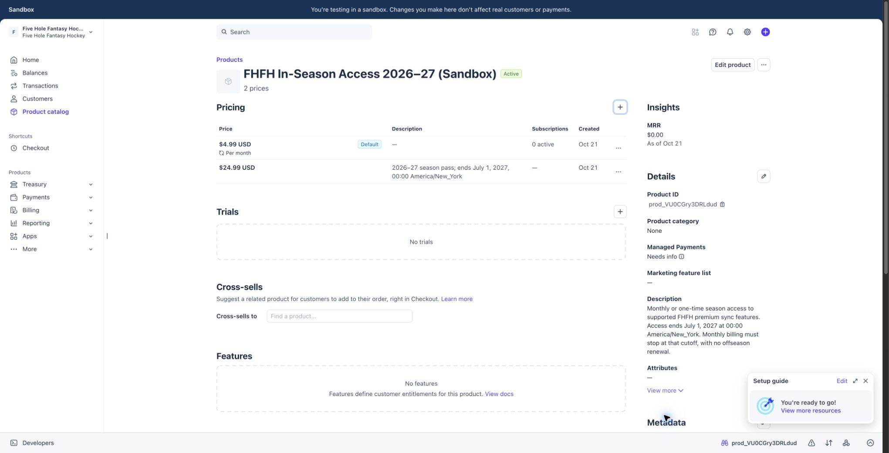

# In-season sandbox billing handoff — 2026-10-21

**Draft location correction (2026-10-22):** the unchanged sandbox billing SQL is retained at
[drafts/20261021210000_in_season_sandbox_billing.sql](drafts/20261021210000_in_season_sandbox_billing.sql),
outside the active migration chain. Its SHA-256 remains `d78b385ec6b8acfbfcc6ba2909d5f558765cd90e8e4a18a2febab68bf146db12`.
Historical receipts/manifests retain the former `supabase/migrations/` path as evidence of what
was tested; resolve that path to this draft for current file-hash checks. This relocation grants
no canonical-source, hosted-apply or deployment authority.

**Latest local correction:** [same-owner cancellation continuity](cancellation-owner-refresh-2026-10-22/HANDOFF.md) preserves unresolved cancellation request IDs across token refresh for the same owner, clearing them on owner change/sign-out. It changes only the account panel and its test; other entrypoint/core files remain hash-identical. The new pinned correction needs independent re-review; activation and service gates remain held.

**New local packet, 2026-10-22:** [inactive account and worker entrypoints](inactive-entrypoints-2026-10-22/HANDOFF.md) adds guarded monthly signup/cancellation UI, owner-only subscription lookup and an authenticated one-job worker route with truthful failure reporting. New flags default off; none were configured. **307/307 tests**, full TypeScript and targeted lint passed. Exact hashes/patches cover five application files, three tests and one unapplied owner-lookup SQL review draft. The prior 11-file correction union is unchanged. This increment needs its own independent review and isolated RPC/service verification; there is no active schedule, live support or deployment.

**Current readiness, 2026-10-22:** [billing owner handoff](READINESS-OWNER-2026-10-22.md) reconciles the implemented paths, accepted review corrections and remaining local/service/release work. Sol's latest independent re-review closed both final findings, reran **235/235 tests**, reproduced both original cases successfully and matched all seven correction hashes. Current hashes also match the latest manifests across the 11-file correction union. Public monthly checkout and automatic execution remain disabled; provider adjustment/recovery proof and production readiness remain open.

The frozen [job isolation and confirmed failure identities](job-isolation-failure-identities/HANDOFF.md) correction passed **235 tests in one six-file run**, TypeScript and targeted lint. The subsequent [real PostgreSQL queue verification](queue-sql-verification/HANDOFF.md) passed **14 check groups** after applying the unchanged draft SQL only to a fresh disposable loopback database. Bounded urgent selection, rotation beyond one batch, unresolved/failed job retention and fencing were executed against PostgreSQL; all seven source hashes remained unchanged. Cleanup recorded the temporary server stopped. No production or retained earlier database was updated. This executed SQL receipt resolves the latest review's explicit SQL execution limitation, without proving deployed scheduling.

The preceding [attempt-specific manual retry recovery](manual-retry-recovery/HANDOFF.md) retains its durable receipt strategy; its 153-test result is historical and overlaps the latest run. The earlier [109-test count-only checkpoint](decline-recovery-fix/HANDOFF.md) is superseded, not the current implementation.

The [three-P1 review correction handoff](review-fixes/HANDOFF.md) records the preceding seven-file delta, with **366 tests passing in one 12-file run**, TypeScript and targeted lint passing. Per the parent's follow-up, Sol independently closed those three findings, matched all seven hashes and reran 72 tests successfully. These counts overlap the newer focused run and are not additive.

The earlier [SANDBOX-E2E-HANDOFF.md](SANDBOX-E2E-HANDOFF.md) supersedes the original setup/execution blockers below. That approved isolated run used 3/3 hosted checkout cases, real local Auth/PostgreSQL, monthly test clocks and retry/cutoff execution. The subsequent [natural-cutoff follow-up](NATURAL-CUTOFF-HANDOFF.md) proved automatic July termination of a still-paying subscription without a July invoice or worker action. Its 338-test result is historical and overlaps the latest 366-test run. Public monthly checkout and automatic billing execution remain disabled. Refund verification is still blocked by the specific pending Stripe dashboard approval as of the last authorized read; live release is not authorized.

The remainder of this document records the **earlier local implementation checkpoint**. Statements below that no credentials, database writes, subscriptions or payments occurred apply to that earlier phase only. Current results, exact nine-file fix delta, cleanup and remaining limitations are in the linked E2E handoff.

Local implementation is partial and intentionally unavailable for live billing. Sandbox product/price creation is complete. No customer payment, subscription, grant write, credential configuration, webhook endpoint setup, migration application, commit, push or deployment was performed.

**Latest local increment:** the monthly charging/schedule adapter, durable-storage adapter and draft RPCs, signed webhook dispatch, retry/cleanup executor, cancellation endpoint and season-pass adjustment handling are now written. **323 tests across 10 files passed in one run**, with full TypeScript and targeted lint also passing. [INTEGRATION-HANDOFF.md](INTEGRATION-HANDOFF.md) is the current executable-path/verification handoff; [INTEGRATION-CHANGED-FILES.json](INTEGRATION-CHANGED-FILES.json) lists its exact 18 implementation/test/schema paths. Public monthly checkout remains disabled, the worker has no automatic trigger, and SQL/Stripe end-to-end execution remains unverified. The 281-test policy and 291-test season-pass receipts below are historical overlapping runs, not additional distinct tests.

## Verified Stripe sandbox receipt

Browser: the user's local Chrome, existing **Five Hole Fantasy Hockey sandbox**, account `acct_1UDRxGLaomqkve47`. The sandbox banner and `/test/` URL were visibly confirmed before creation. All new objects were created once and their saved detail/list rows inspected before proceeding.

| Object | ID | Verified configuration |
|---|---|---|
| Separate product | `prod_VU0CGry3DRLdud` | FHFH In-Season Access 2026–27 (Sandbox), active |
| Monthly price | `price_1UT2C4Laomqkve47zG3qQJq2` | USD 499 cents, recurring monthly |
| Season-pass price | `price_1UT2FBLaomqkve47tXDflfKF` | USD 2499 cents, one-time; description ends July 1, 2027, 00:00 America/New_York |

[Open the saved sandbox product](https://dashboard.stripe.com/acct_1UDRxGLaomqkve47/test/products/prod_VU0CGry3DRLdud).



The existing Draft Pro product `prod_VDtr5clMeJ09yF` and its $5.99 price were not edited. The monthly **price alone does not stop renewals**: no subscription was created. The local adapter now creates a finite schedule with cancellation at its final July cutoff phase, but this has only been verified with mocks. No live product, price, subscription, key, webhook endpoint or account setting was changed. No unnecessary customer/payment details were opened.

## Local implementation

- New sandbox-only season-pass Checkout adapter: authenticates the requesting account, checks the shared premium entitlement, rejects duplicate eligible purchases, validates the separate catalog/account/amount, and caps Checkout expiration before `2027-07-01T04:00:00Z`. Durable attempt IDs provide stable Stripe idempotency keys and retry arguments; uncertain old unattached attempts require review instead of creating another payment.
- New isolated webhook route uses raw-body signature verification, rejects live events, and dispatches monthly invoice/subscription/adjustment events and season-pass completion/adjustments. Fresh payment, refund and dispute facts are reconciled under fenced leases before projecting payment-specific grants. Browser redirects grant nothing; failed verification/persistence returns an error for retry.
- The **unapplied** migration now defines service-only checkout and monthly state/payment/event/job RPCs. Owner binding, unique payment references, atomic state/grant/outbox writes and accounting snapshots are authored; SQL execution, concurrency and RLS behavior have **not** been exercised against a database. Grant writes are restricted to the corresponding sandbox purchase reference, preserving independent supporter, grandfather and legacy grants.
- New account `in-season` section shows the $4.99 monthly / $24.99 one-time season-pass terms and existing access. Season checkout remains disabled without explicitly approved isolated test setup. Monthly checkout is disabled and returns a setup/verification-blocked response even if configuration exists.
- Shared sync upsells and Yahoo setup links now use `/account?section=in-season`; anonymous sign-in uses `/auth?mode=sign-in`. No monthly/season membership CTA points at the legacy $5.99 checkout. Existing Draft Pro-specific purchases/features retain their separate legacy destination.
- Free manual workflows and earlier provider gates are unchanged in this billing increment. No local plans or provider data were cleared. The internal monthly adapter and executor now implement the approved cancellation/grace/expiry rules, but public purchase activation, isolated service execution and browser payment behavior remain unverified and disabled.

New runtime is guarded by explicit sandbox enablement, a test key, the exact approved sandbox account, loopback application and database URLs, and non-production Node mode. It never falls back to `STRIPE_SECRET_KEY`, legacy catalog IDs or a hosted database. No environment file was read for secrets or changed.

## Surface and route inventory for this increment

| Surface | Destination/behavior |
|---|---|
| Account Yahoo and Fantrax notices | Shared `ProviderSyncNotice` → `/account?section=in-season` |
| Draft dashboard sync notice | Shared notice → same in-season section |
| Starter Board and Game Grid sync notices | Shared notice → same in-season section |
| Yahoo Live Draft setup step and upsell | Same in-season section; setup label now Premium sync |
| RSO sync price explanation | Text only; no legacy checkout link; existing manual continuation preserved |
| Account Premium sync section | New `InSeasonPanel`; no entire free page is gated |
| `GET /api/v1/account/in-season/checkout` | Read-only local configuration availability; no provider/Auth/DB calls |
| `POST /api/v1/account/in-season/checkout` | Authenticated owner, shared entitlement check; season pass only; monthly 409 setup/verification block; unavailable setup/access checks 503 |
| `POST /api/v1/webhooks/in-season-stripe` | Separate signed sandbox monthly and season-pass event handlers; legacy webhook unchanged |
| `POST /api/v1/account/in-season/cancel` | Authenticated owned monthly subscription; immediate saved access cancellation and stop job; no premium requirement |
| `createMonthlyBilling` / `runMonthlyBillingJobs` | Internal adapters only; no public creation or cron/worker trigger added |
| `/api/v1/account/draft-pro/checkout`, `/api/v1/webhooks/stripe` | Unchanged legacy contract; existing regression tests pass |

The earlier complete provider UI/server/OAuth/automatic-refresh inventory remains in `../provider-sync-paywall-2026-10-21/REPORT.md`. That report's old upgrade-destination warning is superseded by this increment; its unresolved legacy-grant cohort issue remains.

## Exact changed paths

The initial billing phase changed **15 implementation/test/schema paths**; the policy checkpoint brought the cumulative count to 21. Including executable wiring, `CHANGED-FILES.json` now inventories **29 distinct implementation/test/schema paths: 20 application, 8 tests, 1 unapplied migration**. The latest integration delta is **18 paths: 13 application, 4 tests, 1 draft schema**, including 10 paths already changed in earlier billing phases. AccountSettingsPage, YahooLiveDraftPanel, ProviderSyncNotice and providerSyncAccess already contained the earlier sync-paywall work; the initial billing phase added only the in-season section/CTA changes there. Other concurrent dirty files are preserved.

The earlier phase's 55 application/test paths are a separate inventory, not 55 new billing files. Its **636 tests were deduplicated latest-per-file evidence across overlapping runs**, not one final 636-test run. Do not add that count to the results below as though all tests were distinct.

## Earlier season-pass verification (historical)

Node **22.11.0**, npm **10.9.0**, from `web/`; no GIT_DIR override, dependency install or lockfile change.

Final focused invocation:

```sh
npm test -- lib/in-season/billing.test.ts lib/in-season/billingRoutes.test.ts components/account/InSeasonPanel.test.tsx __tests__/components/account/AccountSettingsPage.test.tsx __tests__/components/DraftDashboard/YahooLiveDraftPanel.test.tsx lib/in-season/commerce.test.ts lib/in-season/access.test.ts lib/integrations/providerSyncAccess.test.ts lib/integrations/providerSyncPaywall.test.ts lib/integrations/stripe/checkout.test.ts lib/integrations/stripe/fulfillment.test.ts --reporter=default --reporter=json --outputFile=../tasks/artifacts/in-season-billing-2026-10-21/TEST-RESULTS.json
```

**Passed: 11 files, 291 tests in one final run**, zero failures. `TEST-RESULTS.json` is the machine-readable receipt. This includes new billing/route/UI cases and existing entitlement, commerce, provider-gate and legacy Stripe regressions. Monthly cancellation, 48-hour grace, three-failure/expiry and DST behavior are pure contract tests, not proof of Stripe collection behavior. Database atomicity is reviewed SQL, not executed evidence.

Targeted ESLint passed with zero errors and one pre-existing AccountSettingsPage `` warning:

```sh
npx eslint lib/in-season/billing.ts lib/in-season/billingConfig.ts lib/in-season/billingStore.ts lib/in-season/billing.test.ts lib/in-season/billingRoutes.test.ts pages/api/v1/account/in-season/checkout.ts pages/api/v1/webhooks/in-season-stripe.ts components/account/InSeasonPanel.tsx components/account/InSeasonPanel.test.tsx components/account/ProviderSyncNotice.tsx components/account/AccountSettingsPage.tsx components/DraftDashboard/YahooLiveDraftPanel.tsx lib/integrations/providerSyncAccess.ts __tests__/components/DraftDashboard/YahooLiveDraftPanel.test.tsx
```

Type-check: **passed** (exit 0), command `NODE_OPTIONS=--max-old-space-size=8192 npx tsc --noEmit --incremental false`. The first invocation found a new webhook Buffer/Uint8Array type mismatch; that issue was corrected before the final focused test run. `git diff --check` passed. No build/deployment, browser checkout execution, database test or provider/cron request occurred.

## Current blockers and next steps

Accepted sources read: `web/lib/in-season/commerce.ts`; `tasks/artifacts/security-audit-fixes-2026-10-18/Q-02-auth-entitlements-billing.md`; RSO PRD's grandfather/preview requirements; the billing-blocker register; subsequent trusted TJ approvals. The new approvals supersede Q-02's pending proration/refund/post-cutoff entries. Complete current detail is in `INTEGRATION-HANDOFF.md`; `MONTHLY-LIFECYCLE.md` records the earlier policy-only checkpoint.

1. **The requested business policies are now approved and locally modeled.** Inclusive calendar-day half-up proration and decline-below-verified-minimum behavior, manual refunds, payment-specific disputes and season-end void/clear behavior are tested. First-100 grandfather membership/order/refund handling remains unresolved; no cohort assignment was added. Tax/legal terms remain unchosen.
2. **Executable local integration is written; service behavior is unverified.** The monthly adapter uses a finite subscription schedule with cancellation at the final July cutoff phase, an explicit initial invoice item and calendar phases across DST. Durable adapters, signed dispatch and a bounded executor are implemented. Test clocks must prove actual initial invoice/payment-method collection, DST transitions, renewals, cancellation and cutoff; a mock schedule is not that proof. See [Stripe subscription schedules](https://docs.stripe.com/billing/subscriptions/subscription-schedules) and the current integration handoff.
3. **Sandbox E2E blocked by excluded permissions (pending, not denied):** approved test-key access/configuration for the exact sandbox, webhook signing-secret setup and endpoint/forwarder access, and disposable isolated local Supabase/Auth storage with permission to apply the draft migration there. Required names are `IN_SEASON_BILLING_SANDBOX_ENABLED`, `IN_SEASON_SANDBOX_ORIGIN`, `IN_SEASON_STRIPE_SECRET_KEY`, `IN_SEASON_STRIPE_WEBHOOK_SECRET`, plus isolated existing Supabase URL/public/service-role configuration. No values were created, accessed or configured. Do not substitute production storage. Sandbox customer/payment/decline/replay scenarios need an explicit bounded test authorization after setup.
4. **Adjustment handling is now wired locally for both plans.** Full completed refunds and disputes affect only the relevant payment, later wins restore only original unexpired coverage, and independent grants remain. Executed database persistence and real sandbox adjustment events are still unverified. Legacy Draft Pro refund handling is unchanged.
5. **Retained grant scope:** the previous sync gate intentionally preserves every currently valid legacy Draft Pro grant, including a new valid legacy $5.99 purchase. The user has not supplied a purchase-date/cohort rule that permits narrowing that access. Correcting the upsell destination does not establish the first-100 cohort. Do not silently revoke rights.
6. **Live release is separate and unapproved:** live catalog/credentials, webhook exposure, reviewed migration strategy, tax/refund/customer terms, deployment and live validation all need their own approval. The sandbox-specific schema/configuration is not a production deployment candidate.

No auto-review denial is outstanding. The earlier browser switch blocker was resolved by the user's switch into the existing sandbox. Both object-creation outcomes are confirmed; there is no uncertain Stripe mutation to retry.
