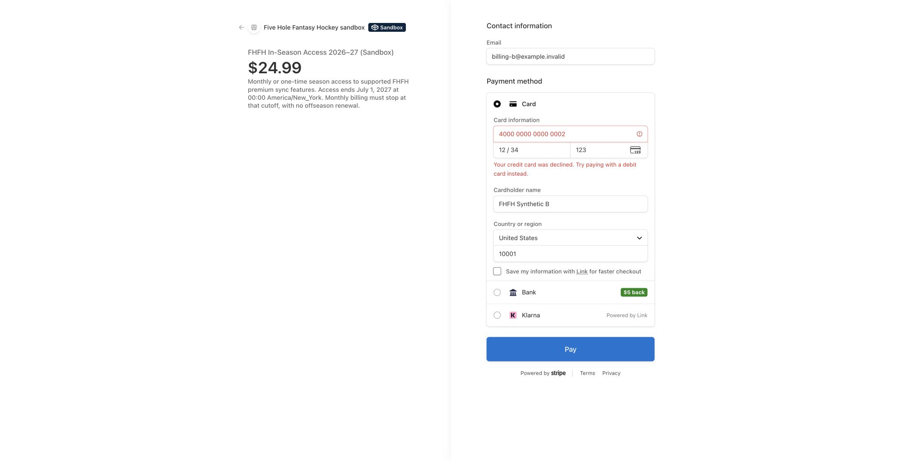

# Isolated billing verification handoff — 2026-10-21

**Latest follow-up:** [Natural-cutoff verification](NATURAL-CUTOFF-HANDOFF.md) is complete. A separate still-paying subscription ended automatically at the July boundary with no July invoice and no cancellation/worker call. The scheduled-request/actual-end timestamp fix passed 338 tests in one final run, TypeScript and lint. The earlier 335-test results below remain historical evidence.

The approved local/sandbox experiment is complete to its current approval boundary. **Three of three hosted checkout cases were used.** Real monthly clock payments, two controlled retries, stop-billing and July cleanup ran against the one task-owned sandbox subscription. Local fixes are written and **335 tests passed in one 10-file run**, with full TypeScript and targeted lint passing. **This is not a release-ready or enabled payment flow.** Public monthly checkout still returns 409 and no automatic billing worker is enabled.

The $1 partial refund is still blocked by Stripe's dashboard approval gate, despite the owner's chat acknowledgement. Latest readback at **18:34:36 UTC**: `requires_review`, refunds empty. No refund was resubmitted. Real full-refund and dispute reconciliation remain unverified.

## Verified environment and cleanup

- Only **Five Hole Fantasy Hockey sandbox `acct_1UDRxGLaomqkve47`** was used. Product `prod_VU0CGry3DRLdud`, monthly price `price_1UT2C4Laomqkve47zG3qQJq2` (499 cents), one-time season price `price_1UT2FBLaomqkve47tXDflfKF` (2499 cents). Legacy $5.99 Draft Pro product was untouched.
- Created exactly the approved agent-tagged restricted key, **FHFH isolated billing E2E 2026-10-21**, with only the approved scopes. No standard/live key was copied. It remains in private local test storage for pending verification, not application/production configuration, Git or logs. No public dashboard webhook was registered.
- Disposable native PostgreSQL 17.11 fixture, then separate Colima/Supabase project with real Auth/REST and exactly two synthetic users. Verified loopback-only exposed ports before writes. Required prerequisite and draft billing SQL ran **only in those disposable databases**. No hosted/production migration was applied and no schema source changed in this increment.
- **Cleanup verified at 18:39:15 UTC:** Stripe forwarder, HTTP harness, native PostgreSQL, Supabase services and the task Colima profile stopped. Ports 3107, 56421, 56422, 56424 and 65439 have no listeners. Data retained for resuming the pending check; private directory mode 0700 and credential files 0600. [Cleanup receipt](SANDBOX-CLEANUP.json).
- Canonical `octoberBranch`; final observed HEAD `07c7f71aff516e4898b4102300a59a3cf8410b11`. Concurrent commits since the earlier checkpoint did not change these billing paths. This task made no commit, push, merge, build or deployment and preserved unrelated dirty/untracked work.

## Actual service evidence

| Check | Observed result |
| --- | --- |
| Native PostgreSQL | **18 checks passed:** real draft SQL execution, separate-connection fencing, rollback, owner/payment binding, role denial, grant and job persistence, independent grandfather/manual preservation. Minimal SQL Auth fixtures in this phase. [Receipt](LOCAL-SQL-RESULTS.json) |
| Real local Auth/PostgREST | **8 checks passed:** two synthetic sign-ins, real API identity binding, anonymous/invalid denial, separate owner attempts, service-only RPC/table restrictions, central free-access result and manual preservation. The initial table-denial probe used a nonexistent table; it was corrected and a read-only follow-up verified actual table denial 42501 for anonymous and both users. [Receipt](LOCAL-AUTH-RESULTS.json) |
| Hosted case 1 | $24.99 season success; real CLI-signed webhook returned 200 and persisted one purchase grant ending July 1, 2027 04:00Z. Signed event replay returned duplicate; tampered body returned 400. |
| Hosted case 2 | Documented synthetic decline; PaymentIntent required a new method with `card_declined`; no grant. Its existing declined Checkout was expired before case 3. |
| Hosted case 3 | Abandonment; Checkout remained open/unpaid and grant count was zero, verified **before** later monthly testing gave that synthetic user monthly access. No fourth hosted Checkout. [Budget](SANDBOX-CASE-BUDGET.json) |
| API boundaries | Anonymous checkout 401, forged account field 400, public monthly checkout 409. Final anonymous cancellation 401 and cross-account cancellation 404 against the real stored subscription. |
| Monthly initial payment | Internal adapter created one clock/customer/finite schedule/subscription. Actual initial invoice was **177 cents on October 21**, with access through November 1 Eastern midnight. No public monthly checkout activation. |
| Renewals/DST | Seven actual 499-cent invoices, November–May. One zero-value fall-DST deferral invoice granted nothing. No premature paid December charge; spring invoice's UTC period end was handled while access remained capped at Eastern midnight. |
| Failure/grace/retries | June 499-cent invoice declined. Original virtual failure June 1 05:00Z; grace ended June 3 05:00Z. Real executor retries at +24/+48 hours both definitively declined. Stored attempts became 2 then 3; third failure ended access. Conflicting automatic collection was disabled only on this task-owned invoice and freshly checked by the executor. |
| Billing stop | Queued stop job canceled the existing schedule/subscription, without proration or a final charge. Provider status read back `canceled`; snapshot retained. |
| July cleanup | Same clock advanced to July 1 07:00Z. Cutoff job voided the unpaid June invoice, retained accounting history, and completed. Final inventory: **8 paid invoices (177 + 7×499), 1 zero-value invoice, 1 void invoice; no July invoice**. No draft or pending item existed, so deletion branches remain mocked. |
| Stored access/manual work | Central loader read actual stored grants at virtual cutoff: monthly false and season false. Manual workspace remained intact. Both retry jobs, stop and cutoff jobs finished with accounting snapshots. [Final readback](SANDBOX-FINAL-READBACK.json) |

The subscription had already been canceled after June failures. That first no-July-charge observation proves its cancellation/cleanup path. The separate [natural-cutoff follow-up](NATURAL-CUTOFF-HANDOFF.md) now proves automatic termination for a still-paying subscription, without a stop/cleanup worker.

Stripe test-clock events and Charges retained wall-clock creation timestamps. The harness explicitly translated first-failure time using the bound invoice-payment allocation/finalization timestamp. Future events were signature-checked and passed to the real reconciler with explicit virtual `now`. SQL leases remained on wall time. For future jobs only, the isolated fixture temporarily translated `due_at` during the real claim RPC and restored it **before external execution**. Actual Stripe operations, service RPC persistence and readbacks ran; this is **not** proof of a deployed scheduler or a native virtual-time SQL API. The real wall-time season webhook did run through temporary HTTP forwarding.

## Exact code delta from the 323-test checkpoint

All paths are under `web/lib/in-season/`. No dependency, lockfile, generated type or CI changes by this task.

| File | Change prompted by actual integration evidence |
| --- | --- |
| `billingConfig.ts` | Accept dedicated `rk_test_` credentials under the same sandbox/account/loopback guards. |
| `billing.ts` | Recheck time after creating the durable attempt; permit only bounded five-second server clock skew. |
| `monthlyBilling.ts` | Same post-persistence time and finite-date safeguards for monthly creation. |
| `monthlySchedule.ts` | Permit consumed initial invoice items only during subsequent verification; distinguish actual UTC invoice periods from Eastern access periods. Creation remains strict. |
| `monthlyStripe.ts` | Validate current typed invoice-parent subscription bindings; reject conflicting legacy/foreign bindings; recognize consumed initial item after independent invoice verification. |
| `monthlyWebhook.ts` | Validate actual zero-value DST invoice shape using exact phase timestamp/index/line bounds, including Stripe's retained original trial start. No access from a zero invoice. |
| `monthlyExecutor.ts` | Require fresh `invoice.auto_advance === false` before a controlled retry to prevent competing automatic collection. |
| `billing.test.ts` | Restricted-key and bounded clock-skew regressions. |
| `monthlyIntegration.test.ts` | Current provider parent shapes, consumed item, clock skew, DST invoice/coverage and automatic collection guard regressions. |

[Exact increment manifest](SANDBOX-E2E-CHANGED-FILES.json): **7 application + 2 test paths**, all already in the cumulative billing inventory. [Cumulative billing manifest](CHANGED-FILES.json): **29 distinct application/test/schema paths**. Artifacts/diary are listed separately. Earlier provider surface/route inventory and its 55 application/test paths remain in [the provider audit](../provider-sync-paywall-2026-10-21/REPORT.md).

Membership sync CTAs use `/account?section=in-season`, sign-in `/auth?mode=sign-in`; none advertises 499/2499 membership and routes to legacy $5.99 checkout. Central in-season grants plus existing verified Patreon/grandfathered Draft Pro sources remain authoritative. Selecting a new first-100 cohort is separate from honoring existing valid grants. Free manual tools, public ingestion, disconnect/revoke and local plans remain preserved; Fantrax RSO is still unsupported, not a fabricated adapter.

## Final local commands and results

Node **22.11.0**, npm **10.9.0**, from `web/`; no GIT_DIR override. These are focused tests, not all repository tests.

```sh
npm test -- components/account/InSeasonPanel.test.tsx lib/in-season/access.test.ts lib/in-season/billing.test.ts lib/in-season/billingRoutes.test.ts lib/in-season/commerce.test.ts lib/in-season/monthlyIntegration.test.ts lib/in-season/monthlyLifecycle.test.ts lib/in-season/monthlyStripe.test.ts lib/integrations/providerSyncAccess.test.ts lib/integrations/providerSyncPaywall.test.ts --reporter=json --outputFile=../tasks/artifacts/in-season-billing-2026-10-21/SANDBOX-FINAL-TEST-RESULTS.json
NODE_OPTIONS=--max-old-space-size=8192 npx tsc --noEmit --incremental false
npx eslint lib/in-season/billingConfig.ts lib/in-season/billing.ts lib/in-season/monthlyBilling.ts lib/in-season/monthlySchedule.ts lib/in-season/monthlyStripe.ts lib/in-season/monthlyWebhook.ts lib/in-season/monthlyExecutor.ts lib/in-season/billing.test.ts lib/in-season/monthlyIntegration.test.ts
```

- **Passed:** 335/335 tests, 10 files, zero skipped in one final run; [JSON receipt](SANDBOX-FINAL-TEST-RESULTS.json). Earlier 63/91/129/323/281/291 counts overlap and must not be summed. The provider audit's 636 is deduplicated latest-per-file evidence across overlapping runs, not one run.
- **Passed:** full TypeScript exit 0, targeted ESLint exit 0/no warnings, scoped `git diff --check`. Earlier concurrent `servedForecastLedger.ts` type errors no longer reproduce; this task did not edit that file.
- Harness commands actually used include `node ../tasks/artifacts/in-season-billing-2026-10-21/LOCAL-SQL-CHECK.cjs`, `LOCAL-AUTH-CHECK.cjs`, `SANDBOX-MONTHLY-CHECK.cjs`, `SANDBOX-CLOCK-VERIFY.cjs advance <allowed-date>`, `SANDBOX-CLOCK-VERIFY.cjs verify`, `SANDBOX-JOBS-CHECK.cjs prepare`, `SANDBOX-JOBS-CHECK.cjs run`, and `SANDBOX-FINAL-CHECK.cjs`. Their sanitized receipts are adjacent. **Do not blindly rerun mutating harness modes**: hosted-case cap is exhausted and refund approval auto-executes. They depend on private task configuration and stopped disposable services.

## Remaining blockers and separate release work

1. **Pending, not denied:** approve/resolve the existing [Stripe sandbox $1 refund request](https://dashboard.stripe.com/acct_1UDRxGLaomqkve47/test/settings/approvals/requests/apreq_test_61VcRrl4OlX6lIlYG16VMpuc7lSQy9I9FTdeM4784LQu). Latest [readback](SANDBOX-REFUND-APPROVAL.json) still has no refund. Do not resubmit or create another request. After confirmed execution, resume the isolated listener/storage and reconcile/read back actual access. The listener is currently stopped, so a delayed approval is not automatically ingested locally. Full refund and real dispute outcomes remain unexecuted; no real-money refunds exist.
2. **Unverified, no extra case authorized:** full-refund access removal, real dispute suspension/win, draft/pending-item deletion, fault recovery after unknown provider outcomes and a real scheduled runner. Mocks cover these policy branches, but do not replace service evidence. Any additional hosted checkout beyond three requires fresh approval. New dispute-producing payments must be scoped before execution.
3. **Minimum applicability:** the sandbox experiment explicitly configured 50 cents with sandbox account default currency USD. No eligible live settlement account/currency was established. Do not carry this assumption into live billing. The implementation requires an explicit verified minimum; small initial charges are declined rather than rounded or carried. Calendar-month/leap/DST/day14–15/minimum boundaries have unit coverage; only October21 and the clock transitions were exercised externally.
4. **Separate production approvals:** any live product/price/key/webhook configuration, hosted schema application, deployment, public monthly activation or billing worker trigger. None was performed or authorized. A real runner and verified control of competing retries/collection must exist before activation. Production flags remain untouched; runtime stays sandbox-only and monthly public checkout disabled. First-100 cohort selection and tax/legal terms remain separate decisions; existing valid grants do not depend on selecting a new cohort.

No automatic approval-review denial remains. One connection error was checked against actual clock state before the same idempotent advance was retried successfully. No uncertain duplicate Stripe creation is outstanding. Keep this task/diary open for the pending refund and remaining verification; do not archive it as a completed live payment integration.


